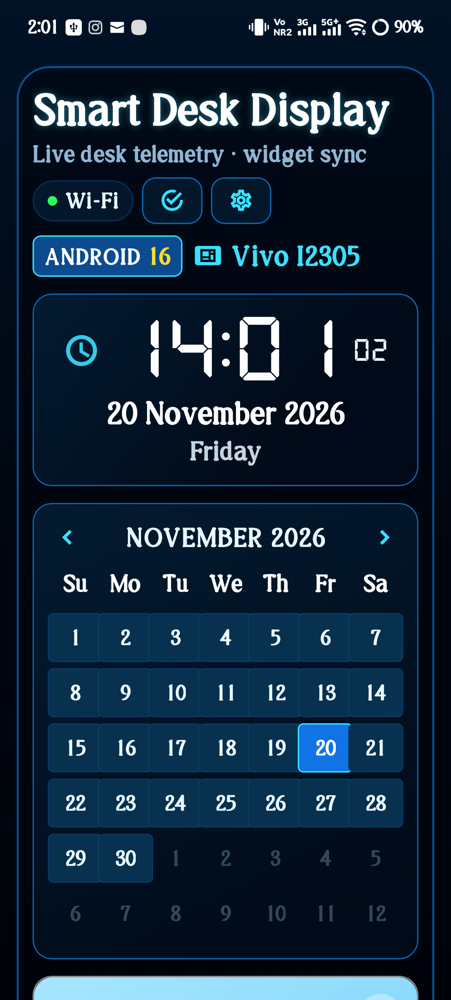
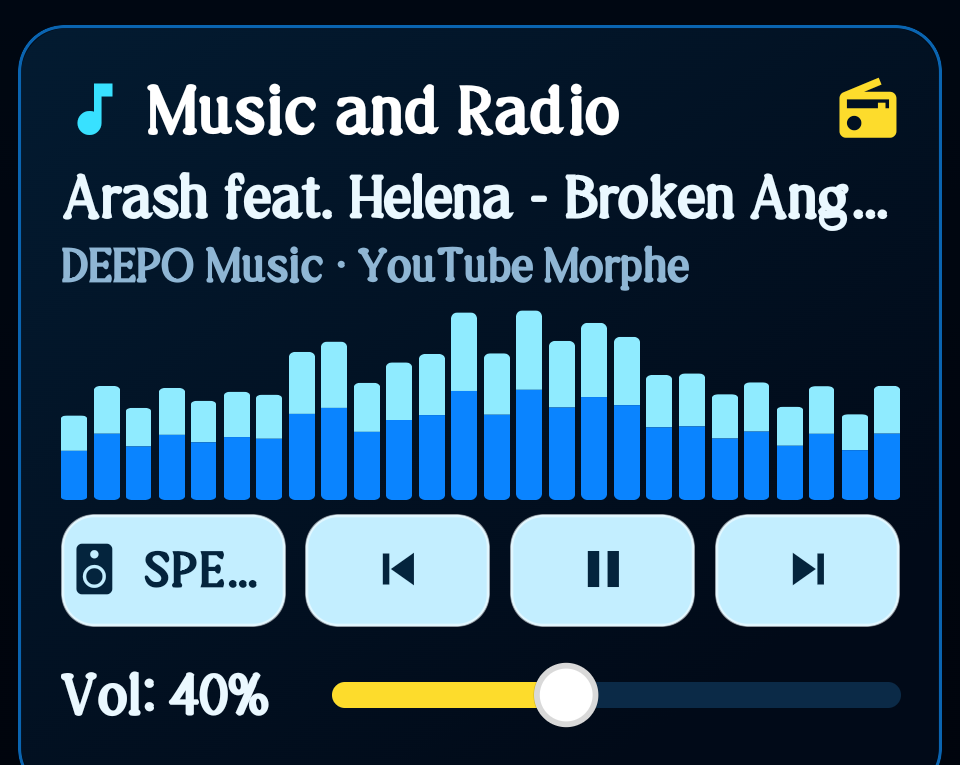
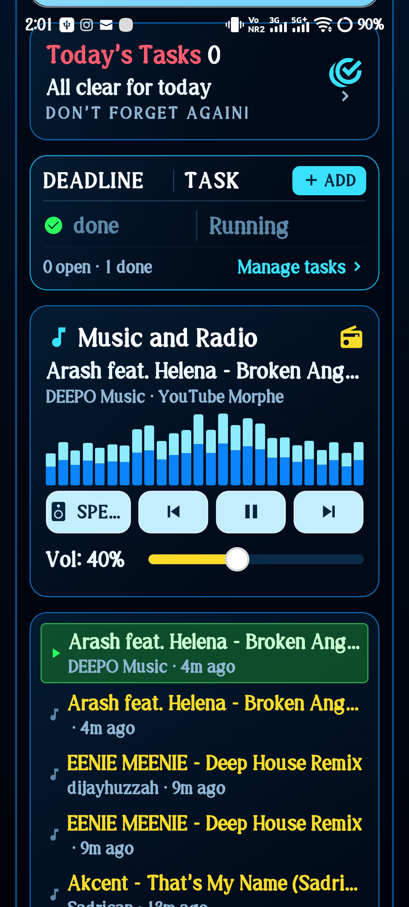
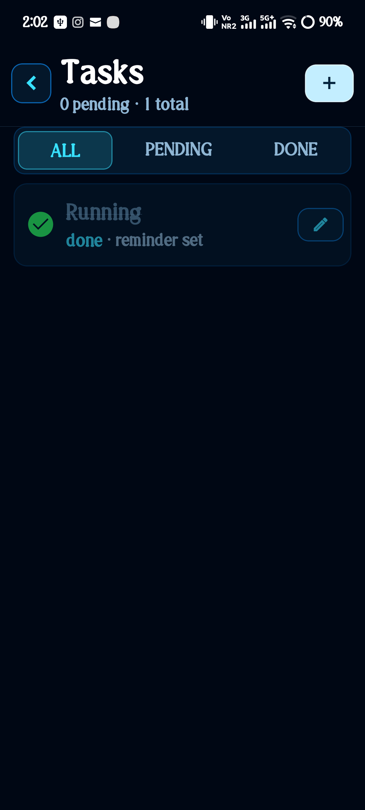
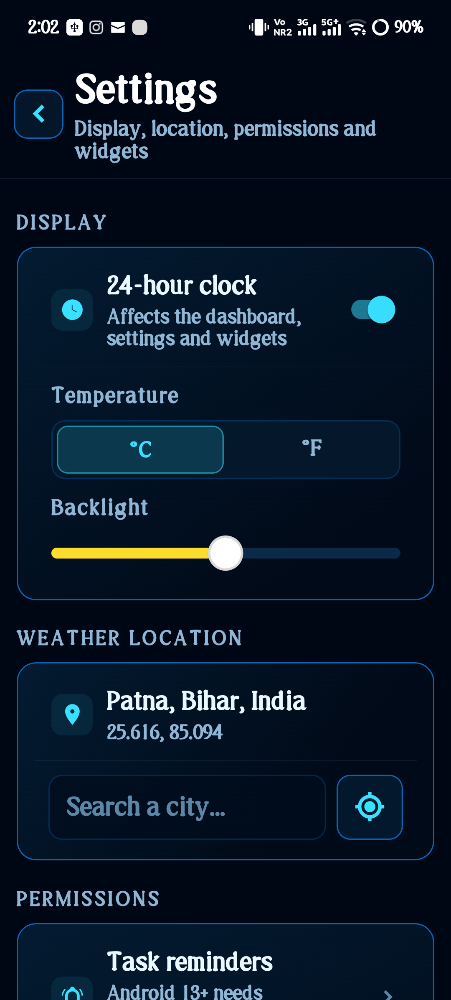
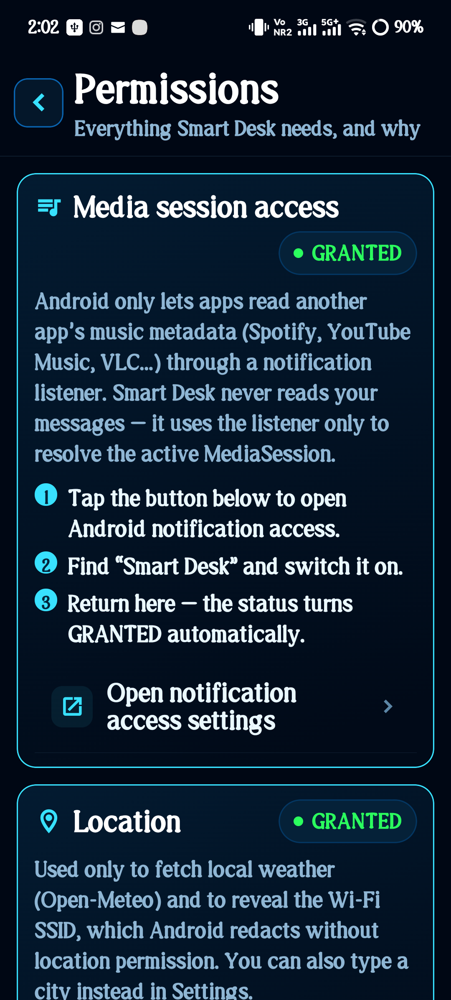
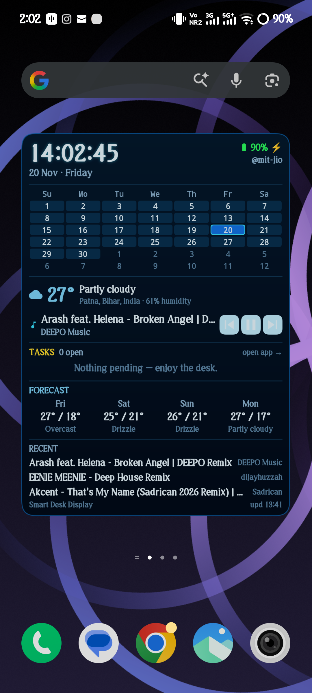
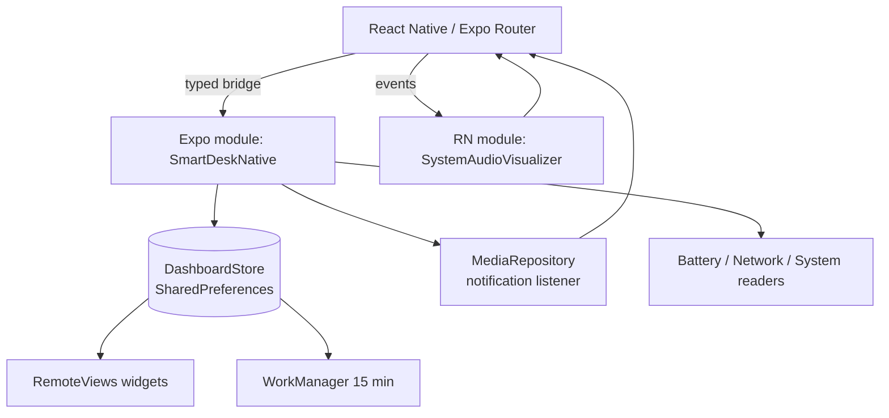

<div align="center">


&nbsp;&nbsp;


# Smart Desk Display

**A wall-mounted Android dashboard that turns an old phone into a desk clock, weather station, task board and music remote — plus a beat meter that actually follows the song.**

Expo SDK 58 · React Native 0.88 · Kotlin · Android 16 (API 36)

[](https://github.com/amiitdev/smart-desk-display/releases/latest/download/smart-desk-display-1.0.0.apk)

[What it does](#what-it-does) · [Screenshots](#screenshots) · [The equalizer](#the-equalizer-how-music-becomes-moving-bars) · [The widgets](#the-widgets-three-panels-that-never-go-stale) · [Download & install](#download-and-install) · [Build it](#build-and-run-it-yourself)

</div>

---

## What it does

Plug the phone in, put it on a stand, and it becomes:

| | |
| --- | --- |
| 🕒 **Clock & calendar** | Big 24-hour clock, today's date and a month grid with today highlighted. |
| 🌤️ **Weather** | Current conditions + 4-day forecast from Open-Meteo (no API key), for GPS or a city you pick. |
| 🎵 **Music remote** | Reads what Spotify / YouTube Music / VLC are playing and controls it: play, pause, next, previous, volume. |
| 📊 **Beat meter** | A real spectrum analyser that animates to whatever is playing through the speaker. |
| ✅ **Tasks** | Tasks with deadlines and reminders, shared live with the home-screen widgets. |
| 🔆 **Display & power** | Backlight slider, battery current/voltage/temperature, charging state. |
| 🖥️ **System & network** | CPU, RAM, storage, Android version, Wi-Fi SSID and signal. |
| 🧩 **Three widgets** | Small, medium and large home-screen panels that mirror the dashboard. |

Everything is local. No account, no cloud, no analytics.

---

## Screenshots

| Dashboard | Music + beat meter | Tasks |
| --- | --- | --- |
|  |  |  |

| Settings | Permissions | Home-screen widget |
| --- | --- | --- |
|  |  |  |

---

## The equalizer: how music becomes moving bars

This is the part that took the most work, so here it is in plain English.

### The problem

Android does **not** let one app listen to another app's audio output. Spotify plays, your app hears nothing. The only "official" way is **screen capture** (MediaProjection): record the display, tap "share audio", run a foreground service.

That works — and it is terrible. It shows a permanent screen-recording notification, adds a permission dialog, costs CPU, makes the whole dashboard sluggish, and on Android 16 it is exactly the kind of background capture that gets throttled. It also *paused the animation* on this device, which is where this refactor started.

So the screen-capture path was deleted entirely: no MediaProjection, no `AudioPlaybackCapture`, no foreground screen-recording service, no `FOREGROUND_SERVICE_MEDIA_PROJECTION` permission.

### The idea instead

Android has an old, boring, built-in audio effect called **`Visualizer`**. Attach it to audio session `0` — "the global output mix" — and the system hands you the actual audio that is being played, without recording the screen.

Two catches on modern Android:

1. **The FFT callback lies.** On Android 14/16 the byte array it returns is clipped and erratic. Measured on this phone: adjacent bins jumped `9 → 217 → 255`, and the whole second half of the buffer came back as `0xFF`. Any equalizer built on those bytes shows a solid block that never moves.
2. **Sometimes session 0 delivers nothing at all.** Depending on the app playing and the OEM audio HAL, `Visualizer(0)` is created successfully and then silently produces zero samples.

### The fix, step by step

```
 press play in Spotify
          │
          ▼
 1. Visualizer(0) attaches to the global output mix
          │
          ├── waveform callback: 1024 samples of 8-bit PCM, 20× per second
          │        │
          │        ▼
          │   2. Hann window → own radix-2 FFT → 512 magnitudes
          │        │
          │        ▼
          │   3. fold 512 bins into 12 logarithmic bands (40 Hz … 15 kHz)
          │        │
          │        ▼
          │   4. dB conversion (-58 dB floor) + beat envelope (fast up, slow down)
          │        │
          │        ▼
          │   5. emit { bands, level } to JavaScript 20× per second
          │
          └── after 1.5 s with no energy?
                   │
                   ▼
            6. fall back to the microphone (16 kHz, UNPROCESSED or VOICE_RECOGNITION)
                   └── same FFT + band pipeline, released the moment playback stops
          ▼
 7. React Native maps 12 bands onto the bars and animates them on the native driver (60 fps)
```

**Why the waveform and not the FFT?** The waveform is plain PCM — the same kind of data the microphone gives us. Running our *own* FFT means both capture paths share one code path, one calibration and one look. The numbers are trustworthy because we computed them.

**Why logarithmic bands?** Music is logarithmic. A linear split gives 90 % of the bars to the top octave and one bar to the kick drum. Twelve log-spaced bands from 40 Hz to 15 kHz put the bass where you can see it, so the beat lands on the left and hi-hats shimmer on the right.

**Why a global ceiling?** Each band is divided by the loudest band of the last few seconds. That keeps the shape of the spectrum (bass tall, treble short) while making quiet passages and drops visible — no per-band auto-gain that would turn hiss into full-height bars.

**Why it looks smooth:** the native side sends 20 frames per second; JavaScript starts an 85 ms `Animated.timing` on the native driver for each band, so the bars are interpolated at 60 fps without a single React re-render.

### The microphone fallback

Some devices — and some apps, including this phone with YouTube — never give `Visualizer(0)` any data. After 1.5 seconds of silence the module does not give up: it opens a low-latency `AudioRecord` at 16 kHz, `UNPROCESSED` when the device supports it (no AGC, no noise suppression) or `VOICE_RECOGNITION` otherwise, and analyses the room. On a desk display the speaker is right there, so the beat is perfectly readable. The recording is stopped and released the moment playback pauses or the screen unmounts, and the card shows a tiny `MIC` badge so you always know which path is live.

### Why it survives `expo prebuild`

The Kotlin lives in the **local Expo module** (`modules/smart-desk-native/…/audio/`), which Continuous Native Generation never touches. Only the *registration* line lives in the generated `MainApplication.kt`, and `plugins/withAudioVisualizer.js` re-adds the import and `add(SystemAudioVisualizerPackage())` on every prebuild. Run `npx expo prebuild` a hundred times — the equalizer still works.

### Code map

| File | Role |
| --- | --- |
| `modules/…/audio/SystemAudioVisualizerModule.kt` | RN module: start/stop, permission, fallback timer, 20 Hz event emission |
| `modules/…/audio/OutputFftSource.kt` | `Visualizer(0)` waveform capture |
| `modules/…/audio/MicrophoneFftSource.kt` | 16 kHz `AudioRecord` fallback |
| `modules/…/audio/AudioFft.kt` | radix-2 FFT, log band mapper, envelope follower |
| `modules/…/audio/SystemAudioVisualizerPackage.kt` | registers the module |
| `plugins/withAudioVisualizer.js` | keeps the registration across prebuild |
| `src/native/systemAudioVisualizer.ts` | typed bridge + frame bus |
| `src/hooks/useBeatCapture.ts` | start/stop + permission retry |
| `src/components/dashboard/BeatEqualizer.tsx` | 34 bars, native-driver animation, full card width |

---

## The widgets: three panels that never go stale

### Why plain RemoteViews and not Jetpack Glance

Glance is the modern widget toolkit, and it does not work on this phone's launcher. It composes a `ViewStub`-based layout; vivo/OriginOS never inflates it, so the widget sits on a white "loading" box forever. This was verified A/B: the same data rendered with plain `RemoteViews` appears instantly, Glance never does. The widgets are therefore built with ordinary framework views — with the constraint that `RemoteViews` only accepts a whitelist of layouts (`<View>` and `<Space>` are rejected at inflation, so spacers are `FrameLayout`s).

### Step by step

```
 1. app writes one document
        │
        ▼
 2. DashboardStore (SharedPreferences "smart_desk_state", schema v1)
        │        ▲
        │        └── widget task toggle writes back atomically
        ▼
 3. WidgetUpdater builds RemoteViews for each size
        │
        ▼
 4. AppWidgetManager.updateAppWidget(...)
```

- **One source of truth.** The app and the widgets read and write the *same* Kotlin store, so a task ticked on the home screen is ticked in the app, and vice versa. No second copy, no sync job.
- **Time costs nothing.** The clock is a native `TextClock`, so seconds tick without waking the app.
- **Events, not polling.** Battery, power and time changes arrive as broadcasts; the app pushes updates when it is open.
- **15-minute WorkManager job** refreshes the weather and the widget while the app is closed.
- **Buttons work from the widget.** Media transport and task toggles are sent as broadcasts through a `PendingIntent` (so they carry the app identity) and handled by `WidgetActionReceiver`.
- **Resizing is real.** Each widget asks the launcher for its current size and adds blocks (media, tasks, calendar, forecast) while a dp budget lasts, so a 2×2 stays compact and a 4×4 fills up.

| Size | What it shows |
| --- | --- |
| **Small** | Clock, date, weather, battery, Wi-Fi; adds media/tasks/calendar when resized taller |
| **Medium** | Clock, weather, media with transport buttons, battery |
| **Large** | Clock with seconds, month calendar, weather, media, next 3 tasks, 4-day forecast, recently played |

---

## Features in detail

### Dashboard
- Clock with configurable 12/24-hour format, date and greeting.
- Month calendar with today highlighted.
- Weather card: current temperature, condition, humidity, location and a 4-day forecast.
- Music card: artwork-free, but shows title, artist, source app, transport controls and a volume slider.
- Tasks card: today's open tasks with one-tap complete and a link to the full board.
- Recently played list (24 entries) written by the notification listener.
- Backlight slider that changes the actual screen brightness.
- Power card: current, voltage, battery temperature, health, charge state.
- System card: CPU, RAM, storage, Android version, density.
- Network card: SSID, signal strength, online state.

### Tasks
- Create, edit and complete tasks with a deadline.
- Local reminders through `expo-notifications` (no server).
- Filter by All / Pending / Done.

### Settings
- 24-hour clock, °C/°F.
- Backlight level.
- Weather location: search a city or use the device GPS.
- Permission shortcuts, widget pinning, clear media history.

### Permissions screen
Every permission explained in plain language with numbered steps and a live GRANTED / REQUIRED badge, so setup never needs a manual.

---

## Architecture



- **UI:** Expo Router screens in `src/app`, Zustand stores, design tokens sampled from the original dashboard artwork.
- **Native:** one local Expo module for telemetry, persistence, media and widgets, plus one small React Native module for audio.
- **Data:** a single shared-preferences document keeps app and widgets identical.

---

## Project layout

```
src/
  app/                  expo-router screens: dashboard, tasks, settings, permissions
  components/
    dashboard/          clock, calendar, weather, music, BeatEqualizer, tasks, power, system, network
    ui/                 Card, Slider, ProgressBar, IconButton/Chip, ScreenHeader, SettingRow
    tasks/              task editor modal
  hooks/                useNow, useDeviceTelemetry, useBeatCapture
  native/               typed bridge, audio bridge + frame bus
  services/             weather (Open-Meteo), notifications
  store/                dashboardStore (persisted), deviceStore (live)
  theme/                colours, fonts, radii
modules/smart-desk-native/
  android/src/main/java/expo/modules/smartdesknative/
    SmartDeskNativeModule.kt   telemetry, media, persistence, settings, widget pinning
    audio/                     FFT sources, band mapper, SystemAudioVisualizer module
    data/                      DashboardStore + schema
    media/                     MediaRepository + notification listener service
    system/                    battery, network, system readers
    widget/                    RemoteViews builders, receivers, refresh worker
plugins/
  withSmartDeskWidgets.js      manifest queries for media buttons
  withAudioVisualizer.js       keeps the audio module registered across prebuild
screenshots/                   images used in this README
```

---

## Download and install

**Latest release: v1.0.0** — `versionCode 1`, `versionName 1.0.0`, minSdk 24, targetSdk 36 (Android 16).

| | |
| --- | --- |
| 📦 **APK** | [`smart-desk-display-1.0.0.apk`](https://github.com/amiitdev/smart-desk-display/releases/download/v1.0.0/smart-desk-display-1.0.0.apk) (84 MB) |
| 🏷️ **Release** | [v1.0.0](https://github.com/amiitdev/smart-desk-display/releases/tag/v1.0.0) |

```bash
# over USB
adb install -r smart-desk-display-1.0.0.apk

# or copy the APK to the phone and tap it
# (allow "install unknown apps" for your file manager the first time)
```

After installing, open **Settings → Permissions** inside the app: it lists every permission with a
numbered walkthrough and a live GRANTED / REQUIRED badge.

> The APK is signed with the debug keystore so it installs without extra setup. Generate your own
> keystore before distributing it anywhere.

### Version history

| Version | Date | Notes |
| --- | --- | --- |
| **1.0.0** | 2026-11-20 | First release: dashboard, beat meter with Android 16 microphone fallback, three widgets, tasks, weather, media remote. |

---

## Build and run it yourself

Requirements: Node 20+, JDK 17, Android SDK with platform 36, a device on `adb`.

```bash
npm install

# generate android/ from app.json + config plugins
npx expo prebuild --platform android

# debug build on a connected device
npx expo run:android

# standalone release APK (signed with the debug keystore — replace before shipping)
cd android && ./gradlew :app:assembleRelease
adb install -r app/build/outputs/apk/release/app-release.apk
```

Useful scripts:

```bash
npm run typecheck     # tsc --noEmit
npm run build:apk     # debug APK
npm run build:release # release APK
```

> Native changes (Kotlin, widgets, manifest) are not picked up by Fast Refresh — rebuild and reinstall.

---

## Permissions and why they exist

| Permission | Used for |
| --- | --- |
| **Notification access** | Reading and controlling other apps' media sessions (Spotify, YouTube Music, VLC). The listener never reads messages — it only resolves the active `MediaSession`. |
| **RECORD_AUDIO** | The beat meter: the `Visualizer` effect and the microphone fallback. |
| **MODIFY_AUDIO_SETTINGS** | The volume slider. |
| **Location (fine/coarse)** | Local weather, and revealing the Wi-Fi SSID (Android redacts it without location). Optional — you can type a city instead. |
| **POST_NOTIFICATIONS** | Task reminders. |
| **RECEIVE_BOOT_COMPLETED** | Re-arming widget refresh after a reboot. |

---

## Tech stack

| Layer | Technology |
| --- | --- |
| App | Expo SDK 58, React Native 0.88.1, React 19.3, TypeScript (strict) |
| Routing | Expo Router (file based, `src/app/`) |
| State | Zustand (persisted dashboard + live telemetry) |
| Native | Expo Modules API + one React Native module, Kotlin |
| Widgets | Plain Android `RemoteViews`, `AppWidgetManager`, WorkManager 2.12 |
| Audio | `android.media.audiofx.Visualizer` + `AudioRecord` + a hand-written radix-2 FFT |
| Storage | Single SharedPreferences document, schema v1 |
| Weather | Open-Meteo (forecast + geocoding), no API key |

---

## Known limits

- The beat meter runs while the dashboard is open — it is a desk display, not a background service.
- Some apps route audio in ways the global `Visualizer` cannot see; those fall back to the microphone (the `MIC` badge tells you).
- The microphone fallback hears the room, so it also reacts to loud speech. It is a beat meter, not a studio analyser.
- The release APK is signed with the debug keystore. Generate a real keystore before publishing.
- The downloadable APK is built for `arm64-v8a` phones of the Android 16 era; rebuild from source for other targets.

---

<div align="center">

Built for a phone that deserved a second life.

</div>
